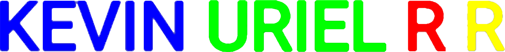

KEVIN URIEL
# 👤DESCRIPCIÓN👤

| Perfil de KevinUrielRR donde se almacenarán proyectos de software |
| --- |
<!-- multiplataforma (Movil, Escritorio, Web, Híbrido)--> <!--algunos con base de datos, otros, solo ejemplos completos de lo que se puede llegar a crear y tutoriales con explicacion--> <!--como ejemplo general de lo que se puede llegar a crear, asi mismo, algunos tutoriales eexplicados paso a paso-->
<!--
***Puedes revisar y apoyarte en estos proyectos para resolver tus dudas o usarlos como ejemplo para poder hacer tus propios proyectos***
-->
 

# PERFIL DE USUARIO 

<!-- |
| --- | -->

| IMAGEN DE USUARIO | PORTADA |
| --- | --- |
|  |  |

 

# DESARROLLO DE SOFTWARE

| PROGRAMACION | FRAMEWORKS |
| --- | --- |
|        |  |

<!--
| HERRAMIENTAS DE SOFTWARE |
| --- |
|  | -->
<!-- |  | --- | -->
<!--</img> |-->

 

# REGISTRO DE ACTIVIDAD

<!--

-->

<!--

-->

<!--

-->
| disminuido | extendido | circular |
| --- | --- | --- |
|  |  |  |

<!--# PROYECTOS DESTACADOS
 |  |

| --- |-->

# PROYECTOS

| SUBIDO RECIENTEMENTE | DESTACADO |
| --- | --- |
|  |  |

| FINALIZADOS | RECIENTEMENTE ACTUALIZADOS |
| --- | --- |
|  |   |
<!-- 
|  |
| --- |-->

<!--
|  |-->

<!--ProyectoLaravelPartidasPresupuestalesTablaSistemaEscolar)
-->

<!--
hihiss://skillicons.dyothisoururyoururyoururrofile
ponprofileee-elRRlRR-**KevinUrielRR/KevinUrielRR** is a ✨ _special_ ✨ repository because its `README.md` (this file) appears on your GitHub profile.
on ne are some ideas to get you startedcurrently’m currently working on ...
- 🌱 I’m currently learning ...
- 👯 I’m looking to col
-
-
-
-
-
-
-
-
-
-
-
-
-yourrlaborate on ...
- 🤔 I’m looking for help with ...
- 💬 Ask me about ...
- 📫 How to reach me: ...
- 😄 Pronouns: ...
- ⚡ Fun fact: ...
-->
